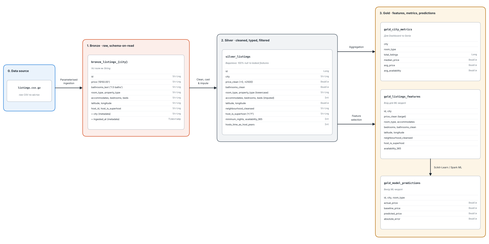

# Canada Airbnb — Databricks Lakehouse and Price Prediction

Group assignment for **Big Data Analytics Workflows with Databricks** (UCU, 2026).

The project uses [Inside Airbnb](https://insideairbnb.com/get-the-data/) listing data to build a bronze–silver–gold Databricks lakehouse, train and evaluate a nightly-price prediction model, and make analytical results available through a Databricks AI/BI Dashboard and Genie Agent.

The assignment also evaluates how well the existing system supports onboarding a previously unseen city.

## 1. Region, Cities, and Data

**Region:** Canada  
**Currency:** Canadian dollars (CAD)  
**Unit of analysis:** One short-term rental listing

| Role | City | Snapshot date | Cleaned listings |
|---|---|---|---:|
| A — Training | Toronto | 2026-09-18 | 16,725 |
| B — Training | Vancouver | 2026-09-17 | 5,145 |
| C — Unseen city | Montreal | 2026-09-14 | 9,058 |
| **Total** | | | **30,928** |

Snapshot dates were determined from the predominant `last_scraped` date in each downloaded dataset.

Toronto and Vancouver contain listings scraped on adjacent dates:

- Toronto: September 18 (19,130 raw records) and September 17 (2,920).
- Vancouver: September 17 (5,054 raw records) and September 18 (1,077).
- Montreal: September 14 (10,717 raw records).

The raw dataset sizes differ from the cleaned listing counts because the ETL pipeline applies data-quality and price filters.

**Data source:** [Inside Airbnb](https://insideairbnb.com/get-the-data/) (CC BY 4.0).

The project uses detailed `listings.csv.gz` files, stored in the Databricks workspace at:

```text
/Workspace/Shared/canada-airbnb/data/
  toronto/listings.csv.gz
  vancouver/listings.csv.gz
  montreal/listings.csv.gz
```

Raw data files are not included in the repository.

Montreal was selected as the unseen city because it provides a geographically distinct Canadian rental market while preserving the same currency and general data structure.

## 2. Architecture

The solution follows the Databricks medallion architecture.



| Layer | Purpose | Main tables |
|---|---|---|
| Bronze | Raw ingestion with city identification | `bronze_listings_<city>` |
| Silver | Data cleaning, type conversion, and missing-value handling | `silver_listings` |
| Gold | Modeling features, city statistics, predictions, and analytics | `gold_listings_features`, `gold_city_metrics`, `gold_model_predictions` |

The curated `gold_listings_analytics` view combines predictions with listing features and serves as one of the data sources for Genie.

All tables are stored in the `airbnb_lakehouse` schema in the configured Databricks catalog.

The ETL pipeline accepts a `city` parameter, enabling the same implementation to process different cities without duplicating the code.

## 3. Repository Structure

```text
canada-airbnb-databricks/
├── architecture/
│   └── layers_architecture.png
├── dashboards/
├── genie/
├── notebooks/
│   ├── 01_eda_and_leakage.ipynb
│   ├── 02_etl_pipeline.ipynb
│   ├── 03_price_model.ipynb
│   ├── 04_1_city_c_evaluation.ipynb
│   ├── 04_2_city_c_fixes.ipynb
│   ├── predict_city.ipynb
│   ├── 05_dashboard.ipynb
│   └── 06_genie_agent.py
└── README.md
```

### Notebook Descriptions

| Notebook | Purpose |
|---|---|
| `01_eda_and_leakage` | Exploratory analysis, data quality, and leakage investigation |
| `02_etl_pipeline` | Parameterized bronze/silver/gold processing |
| `03_price_model` | Original model training, baseline, evaluation, and prediction export |
| `04_1_city_c_evaluation` | Initial Montreal evaluation and identification of integration issues |
| `04_2_city_c_fixes` | Baseline reconstruction, publication fixes, and final verification |
| `predict_city` | Reusable city-specific inference and prediction publication |
| `05_dashboard` | Dashboard creation, updating, and publication |
| `06_genie_agent` | Genie configuration, curated analytics, and instructions |

The original A/B model and training notebook were preserved during city C onboarding.

## 4. Reproducing the Pipeline

### 4.1. Environment

The project was developed for Databricks and uses:

- PySpark and Delta Lake
- pandas and NumPy
- scikit-learn
- MLflow
- Databricks AI/BI Dashboards
- Databricks Genie

The workspace must contain the downloaded listing files and have access to the required catalog and schema.

### 4.2. ETL Execution

Open `02_etl_pipeline.ipynb`.

Set its city parameter:

```python
dbutils.widgets.text("city", "toronto")
city_param = dbutils.widgets.get("city").strip().lower()
```

Supported cities are `toronto`, `vancouver`, and `montreal`.

Run the notebook once for each city to populate the bronze, silver, and gold tables.

The ETL uses city-scoped writes for the shared silver and gold tables. Reprocessing a city replaces its corresponding data while preserving the other cities' partitions.

### 4.3. Databricks Job

The ETL is configured as a parameterized Databricks Job under **Jobs & Pipelines**, allowing cities to be processed without manually executing the notebook.

The existing Job has the following configuration:

| **Setting** | **Value** |
| :--- | :--- |
| Job name | `airbnb_city_etl` |
| Task name | `process_city` |
| Task type | Notebook |
| Notebook | `02_etl_pipeline` |
| Parameter | `city` |
| Example value | `montreal` |

To process a city:

1. Open **Jobs & Pipelines** in Databricks and select `airbnb_city_etl`.
2. Click **Run now** and specify the desired `city` parameter (e.g., `montreal`).
3. Monitor the Job execution and verify the resulting bronze, silver, and gold tables.

The Job reuses the existing ETL notebook without code modifications. Additional cities can be processed by changing the parameter, provided their source files are available and the city is supported by the notebook.

**Note:** Re-executing the Job replaces the selected city's bronze, silver, and gold data. Verify the city parameter and source files before running it. Model inference and prediction publication are handled separately by `predict_city.ipynb`.

### 4.4. Model Training

After loading Toronto and Vancouver, run `03_price_model.ipynb`.

The notebook:

1. Prepares training and testing datasets.
2. Constructs the median-based baseline.
3. Trains a Random Forest regression pipeline.
4. Evaluates prediction performance.
5. Exports predictions to the gold layer.
6. Logs the fitted model through MLflow.

The model is trained exclusively on Toronto and Vancouver.

For the city C experiment, the original trained model was loaded directly from MLflow. It was not retrained.

**Important:** Do not rerun the original training notebook after adding Montreal when reproducing the unseen-city experiment. Its training and full-table publication logic are combined, and doing so could alter the original evaluation conditions.

## 5. Price Prediction Model

The model is a scikit-learn `RandomForestRegressor` with preprocessing implemented using a scikit-learn pipeline.

It uses numeric and categorical listing features, including:

- Location and neighbourhood
- Room and property type
- Guest capacity and bedrooms
- Bathrooms and beds
- Host characteristics
- Availability and minimum nights

Numeric features are scaled, while categorical features are one-hot encoded.

The model predicts log-transformed prices:

$$
z = \log(1+y)
$$

Predictions are transformed back into CAD:

$$
\hat{y} = \exp(\hat{z})-1
$$

### Baseline

The baseline predicts the median training-set price for listings with the same `room_type` and `accommodates`.

When a combination is absent from the training data, the global training-set median is used.

### Evaluation Metric

Model performance is evaluated using mean absolute error (MAE):

$$
\operatorname{MAE}=\frac{1}{n}\sum_{i=1}^{n}|y_i-\hat{y}_i|
$$

Lower MAE indicates better predictive accuracy.

## 6. Original Model Performance

The model was trained on Toronto and Vancouver using an 80/20 training/testing split for each city.

| Evaluation | MAE (CAD) |
|---|---:|
| Baseline — Toronto/Vancouver combined | 109.32 |
| Random Forest — Toronto | 61.24 |
| Random Forest — Vancouver | 92.25 |
| **Random Forest — combined A/B** | **68.53** |

These are held-out evaluation results from the original training notebook.

The combined model achieves approximately a 37.3% MAE reduction relative to the original A/B baseline.

## 7. City C — Montreal Onboarding

The assignment required applying the original ETL pipeline and trained model to a previously unseen city, recording failures, implementing necessary changes, and comparing predictive performance.

### 7.1. Initial ETL and Model Evaluation

The original ETL pipeline successfully processed Montreal without modifications.

It produced **9,058 cleaned listings** in the gold feature table.

All 13 model features were available without missing-value or schema compatibility problems.

The original Random Forest model was loaded from MLflow and generated predictions for every Montreal listing without retraining.

**First-run model MAE: 79.68 CAD.**

### 7.2. Performance Comparison

The original A/B-derived median baseline was reconstructed and evaluated on Montreal.

| Evaluation | MAE (CAD) |
|---|---:|
| **Baseline — Montreal (city C)** | **118.44** |
| **Original model — Toronto/Vancouver (A/B)** | **68.53** |
| **Original model — Montreal (first run)** | **79.68** |
| Model — Montreal after integration fixes | 79.68 |

The original model achieves a **32.7% MAE reduction** relative to the Montreal baseline:

$$
\frac{118.44-79.68}{118.44}\times100\%
\approx 32.7\%.
$$

Montreal's model MAE is approximately **16.3% higher** than the original combined A/B held-out MAE.

This is consistent with some cross-city distribution shift: Montreal differs geographically and may have different relationships between property characteristics and rental prices.

However, the evaluation protocols differ. Toronto and Vancouver were evaluated using held-out observations from cities represented during training, whereas Montreal was entirely unseen. Further analysis would be required to establish the causes of the performance gap.

No model changes were made during onboarding, so the Montreal MAE remained unchanged after the integration fixes.

### 7.3. Initial Integration Issues

Although the ETL and model inference worked without changes, the first downstream integration test revealed several issues.

| Component | Initial behavior |
|---|---|
| ETL | Successfully processed Montreal |
| Model | Successfully predicted Montreal prices |
| Prediction table | Contained only Toronto and Vancouver |
| Genie | Incorrectly reported that Montreal had no listings |
| Dashboard | Included Montreal in general statistics, but not model predictions |
| Dashboard narrative | Initially described only the original cities |

The SQL investigation confirmed that Montreal was present in `gold_listings_features` but absent from `gold_model_predictions`.

Because the Genie analytics view was built from the prediction table, it also excluded Montreal.

### 7.4. Integration Fixes

A separate workflow was implemented in `04_2_city_c_fixes.ipynb` to publish Montreal predictions without changing the original model or replacing existing Toronto/Vancouver predictions.

The resulting prediction table contained:

| City | Prediction records |
|---|---:|
| Toronto | 16,725 |
| Vancouver | 5,145 |
| Montreal | 9,058 |
| **Total** | **30,928** |

After publication:

- Genie correctly reported 9,058 Montreal listings.
- Montreal became available in the curated analytics view.
- Rerunning `05_dashboard.ipynb` updated the model-performance visualizations.
- The dashboard's data-driven narrative headers were regenerated to incorporate Montreal.

No changes to the ETL, fitted model, Genie code, or dashboard generation code were required.

## 8. Reusable City Inference Workflow

### 8.1. Identified Design Limitation

The original `03_price_model.ipynb` combines model training, evaluation, inference, and prediction publication.

This makes onboarding a new city unnecessarily dependent on training-specific code and requires reconstructing intermediate calculations.

Additionally, the original publication logic overwrites the entire prediction table instead of supporting city-specific updates.

### 8.2. Improvement

To address this limitation, a separate **`predict_city.ipynb`** notebook was introduced.

It accepts a city parameter and:

1. Loads the original fitted model from MLflow.
2. Loads the selected city's gold features.
3. Reconstructs the original A/B-derived baseline.
4. Generates predictions without retraining.
5. Calculates baseline and model MAE.
6. Optionally publishes predictions using a city-scoped Delta write.
7. Verifies the resulting prediction records.

The workflow is reusable for any newly ingested city with compatible input features.

Publication is disabled by default:

```python
PUBLISH = False
ALLOW_REPLACE_EXISTING_CITY = False
```

The first execution should be a dry run. Publication should be enabled only after reviewing the output.

The workflow was successfully tested on Montreal and reproduced the existing model and baseline evaluation results.

### 8.3. Remaining Limitation

The baseline lookup is reconstructed from the original A/B training data instead of being persisted as a separately versioned artifact.

For a production system, the baseline lookup and feature definitions should be saved alongside the trained model to improve reproducibility and simplify future inference.

The original training notebook remains unchanged.

## 9. Dashboard and Genie

### Dashboard

`05_dashboard.ipynb` generates and publishes an AI/BI dashboard containing:

- City overview and pricing statistics
- Listing and property characteristics
- Cross-city comparisons
- Model prediction performance

Some dashboard headers are generated dynamically from SQL results at notebook execution time.

Consequently, after onboarding a new city, rerunning and republishing the dashboard notebook updates both the charts and their narrative headers.

### Genie

`06_genie_agent.py` configures the Genie Agent using curated gold data, instructions, and example queries.

The agent supports natural-language questions about listing counts, prices, property characteristics, and city comparisons.

After Montreal predictions were published, Genie successfully recognized Montreal and returned the correct listing count.

Generated SQL should be inspected when verifying answers, especially after changes to underlying data sources.

## 10. Presentation

**[Canada Airbnb — Group Assignment Presentation](https://canva.link/pa61krd55h7yahp)**

The presentation covers the lakehouse architecture, ETL, original model, analytical components, Montreal onboarding, observed integration issues, and final results.

## 11. Conclusions

The project demonstrates an end-to-end Databricks analytics workflow for Canadian Airbnb listing data.

Onboarding Montreal showed that:

- The original ETL pipeline supports additional cities without modifications.
- The original A/B-trained Random Forest can generate predictions for an unseen city without retraining.
- Montreal's model MAE of **79.68 CAD** is substantially better than its baseline MAE of **118.44 CAD**.
- Downstream integration initially failed because predictions had not been published.
- Publishing Montreal predictions and regenerating the dashboard resolved the observed integration problems.
- Separating inference and publication from model training improves extensibility and maintainability.

The main improvement was operational rather than predictive: the system can now score and publish a new city's data using an independently reusable workflow.
